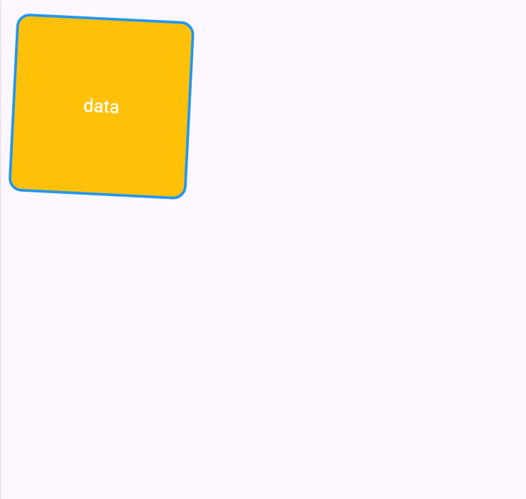
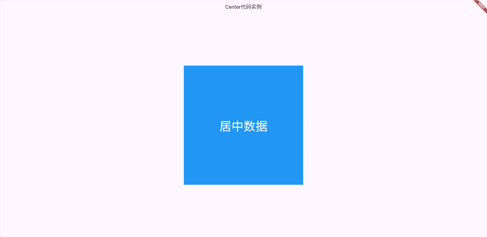

+++
author = "ren517"
title = "flutter的Container和Center组件"
date = "2026-10-11"
description = "今天继续学习flutter"
tags = [
    "Android",
    "学习",
]


categories = [
    "学习",
    "flutter"
]
series = ["Themes Guide"]
+++

### 组件概况

| 组件类别 | 核心组件                          | 主要特点/使用场景                                                    |
| -------- | --------------------------------- | -------------------------------------------------------------------- |
| 基础容器 | Container、Center、Align、Padding | 提供装饰、对齐、边距等基础样式和布局控制，是使用频率极高的组件       |
| 线性布局 | Row、Column                       | 在水平或垂直方向线性排列子组件，是构建界面的基础                     |
| 弹性布局 | Flex、Expanded、Flexible          | 按照比例分配剩余空间，实现自适应布局，常与 Row 和 Column 配合使用    |
| 层叠布局 | Stack、Positioned                 | 让子组件重叠堆叠，用于实现如图片上叠加文字、悬浮按钮等效果           |
| 流式布局 | Wrap、Flow                        | 当主轴空间不足时自动换行或换列，常用于标签、滤镜等动态宽高内容的排列 |
| 滚动布局 | ListView、GridView                | 提供可滚动的列表或网格视图，高效展示大量数据                         |

### 基础容器-Container

- **定义**：Container 是功能丰富的布局组件，是一个多功能组合容器
- **尺寸控制**：可通过多种方式定义大小，有明确优先级规则。
- **优先级**：明确宽高 > constraints约束 > 父组件约束 > 自适应组件大小

案例：


```dart
import 'package:flutter/material.dart';

void main(List<String> args) {
  runApp(const MainPage());
}

class MainPage extends StatelessWidget {
  const MainPage({super.key});

  @override
  Widget build(BuildContext context) {
    return MaterialApp(
      home: Scaffold(
        body: Container(
          transform: Matrix4.rotationZ(0.05),
          margin: EdgeInsets.all(20),
          width: 200,
          height: 200,
          // color: Colors.black
          decoration: BoxDecoration(
            color: Colors.amber,
            borderRadius: BorderRadius.circular(15), // 设置圆角,
            border: Border.all(width: 3, color: Colors.blue),
          ),
          child: Center(
            child: Text(
              "data",
              style: TextStyle(color: Colors.white, fontSize: 20),
            ),
          ),
        ),
      ),
    );
  }
}

```

### 基础容器-Center - 居中组件

- **应用场景：** 页面内容整体居中，如将一个登录表单或一个加载中的提示图标在页面正中显示
- **注意事项：** Center 不能设置宽高，Center 的最终大小取决于其父组件传递给它的约束，Center 会向它的父组件申请尽可能大的空间
- **实现固定宽高且居中的组件：** Center 去包裹一个具有固定宽高的子组件。Container / SizedBox

案例:



```dart
import 'package:flutter/material.dart';

void main(List<String> args) {
  runApp(MainPage());
}

class MainPage extends StatelessWidget {
  const MainPage({super.key});

  @override
  Widget build(BuildContext context) {
    return MaterialApp(
      home: Scaffold(
        appBar: AppBar(title: Center(child: Text("Center代码实例"))),
        body: Center(
          child: Container(
            width: 100,
            height: 100,
            // color: Colors.blue,
            decoration: BoxDecoration(color: Colors.blue),
            child: Center(
              child: Text("居中数据", style: TextStyle(color: Colors.white)),
            ),
          ),
        ),
      ),
    );
  }
}
```
