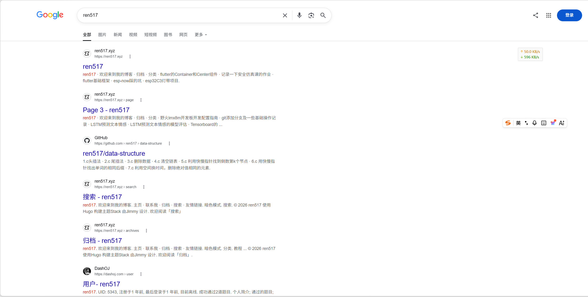
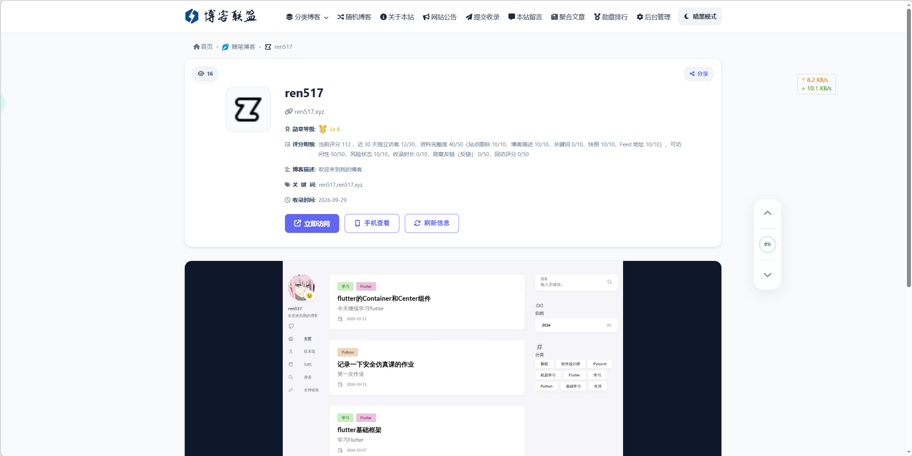

+++
author = "ren517"
title = "我的博客还小，但已经有人来了"
date = "2026-10-11"
description = "关于我通过搜索引擎，看到了有人在关注着我的博客，谢谢大家"
tags = [
    "心得",
]

categories = [
    "心得",
]
series = ["Themes Guide"]
+++

给你改了一版**日记碎碎念风格**的，结构打散，语气像随手记，读起来像翻开一本日记本：

---

# 我的博客居然能被搜到了

前几天闲着没事，在搜索引擎里输了一下我的博客名 `ren517`。

本来真没抱什么希望，就是随手一试。结果——居然搜到了？？

更离谱的是，我还发现有几个博客导航网站收录了我的博客。就是那种专门收集各种独立博客的站点。我盯着屏幕看了好几秒，有点不敢相信。

说实话，这件事给我的冲击挺大的。因为之前我一直觉得我的博客就是个小角落，没什么人会来看。我也就是在上面随便发发日常，偶尔写点技术踩坑记录。能被人看到，已经是意外之喜了；能被搜索引擎收录、被导航站发现，这完全超出我的预期。

---

## 为什么写博客

其实我写博客的初衷特别简单。

我在学习的过程中，遇到过太多问题了。很多时候搜遍全网也找不到一个靠谱的答案，那种无助感真的很折磨人。所以我就想，如果我把这些"花了很长时间才搞懂的东西"写下来，也许就能帮到那个和我一样、正在某个角落里疯狂搜索的人。

我没想过要火，也没想过要多少阅读量。就是觉得，如果能帮到哪怕一个人，这篇博客就值了。

---

## 一颗很早之前就种下的种子

说起"做工具帮到别人"，这个念头其实从小就有了。

初中那会儿我连"开源"是什么都不懂。重装系统想找个好用的 PE，结果被各种捆绑软件搞到崩溃。后来发现了微 PE 工具箱——界面干净，没有强制安装，就是安安静静做好一个工具。虽然后来才知道它也不是开源的，但那种"把一件事做到极致"的态度，真的让我挺震撼的。

原来工具可以是这样的啊。

那时候就在心里埋了一颗种子，想着以后我也要做这样的东西。

---

## 暑假写了个脚本，但一直懒得发

这个暑假其实我做了一个 Python 脚本，可以一键查 XUST 教务系统的成绩。我们学校出分慢，查询入口还不统一，这个痛点困扰我很久了。脚本写完之后，我……一直懒得在博客上发。

现在想想，大概是因为潜意识里觉得"反正也没人看，发不发都一样"吧。

但最近搜索引擎和导航站这件事，让我突然意识到：也许真的有人在找这些东西。我的脚本也许能帮到那些不会编程的同学，让他们也能方便地查成绩。

所以最近开始自学 Flutter 了。目标是在年底前把这个工具做成一个真正的 App。不需要多复杂，只要能让没有编程经验的人也能用，就够了。

小众圈子的工具，也应该能普惠大众嘛。

---

## 就，挺开心的

博客被看见，真的是一件很小的事。

但对我来说，它像是一个信号——**你发出的声音，真的会有人听到。**

我会继续写下去的。也会继续把那些"也许能帮到别人"的想法，一个一个变成现实。

如果你恰好读到了这里，谢谢你呀。

---
